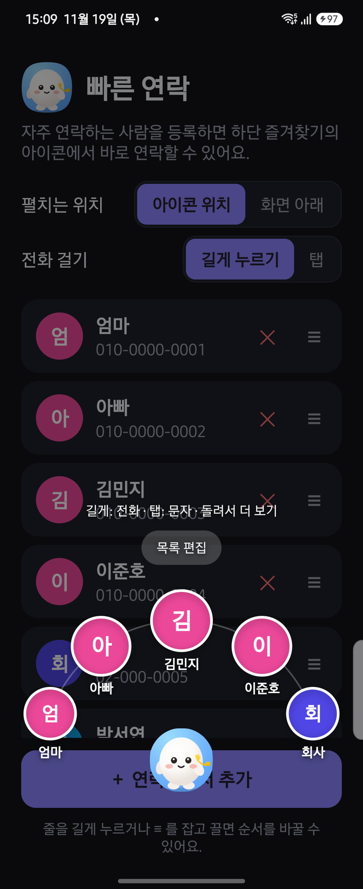
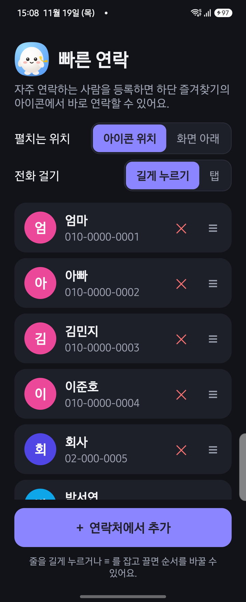

# RiccoCall (릭코 콜)

**자주 연락하는 사람을 아이콘 하나로 바로 부르는 Android 앱**

홈 화면 하단 즐겨찾기에 RiccoCall 아이콘을 두고 누르면, 그 자리에서 연락처가 반원으로 펼쳐집니다.
길게 누르면 전화, 탭하면 문자. 연락처 앱을 열고 찾을 필요가 없습니다.
광고 없음 · 회원가입 없음 · 인앱결제 없음.

  
  

## 다운로드

👉 **[최신 버전 APK 받기 (Releases)](https://github.com/pjh3152/RiccoCall-app/releases/latest)**

`Assets` 항목의 `RiccoCall-x.y.z.apk` 를 받아 설치하면 됩니다.

- 지원 기기: Android 10 이상
- 처음 설치할 때 "출처를 알 수 없는 앱 설치"를 허용해야 할 수 있습니다.
- 새 버전이 나오면 같은 방법으로 받아 덮어 설치하면 등록한 연락처가 그대로 유지됩니다.

☕ 앱이 마음에 드셨다면 [카카오페이로 커피 한 잔 응원하기](https://qr.kakaopay.com/FbUYe4tN3)

## 사용 방법

1. 앱을 처음 열면 **연락처에서 추가** 로 자주 연락하는 사람을 등록합니다.
2. 앱 아이콘을 홈 화면 하단 즐겨찾기(독)에 놓습니다.
3. 아이콘을 누르면 그 위치를 중심으로 연락처가 반원으로 펼쳐집니다.
   - **길게 누르기 → 전화**, **탭 → 문자** (편집 화면에서 반대로 바꿀 수 있음)
   - 사람이 많으면 원을 따라 쓸어서 돌립니다.
4. 목록을 고치려면 펼친 화면의 **목록 편집**, 또는 앱 아이콘을 길게 눌러 나오는 **목록 편집** 메뉴를 씁니다.

## 주요 기능

- 반원 다이얼: 누른 아이콘 위치를 중심으로 펼치기 / 항상 화면 아래 가운데에 펼치기 선택
- 전화·문자 동작 바꾸기 (길게 누르기 ↔ 탭)
- 연락처 사진 자동 표시 (사진이 없으면 이름 첫 글자)
- 끌어서 순서 바꾸기
- 홈 화면 위젯 "빠른 연락"
- 다크 모드

## 권한 안내

| 권한 | 쓰는 곳 |
|---|---|
| 연락처 읽기 | 연락처에서 사람을 고를 때, 그리고 등록한 사람의 사진을 보여 줄 때 |
| 전화 걸기 | 길게 누르면(또는 설정에 따라 탭하면) 바로 전화를 걸 때. 허용하지 않으면 번호가 입력된 전화 앱이 열립니다 |

문자는 기본 문자 앱을 여는 방식이라 별도 권한이 필요 없습니다.
등록한 연락처는 내 폰 안에만 저장되며 외부로 보내지 않습니다. 자세한 내용은 [개인정보처리방침](https://pjh3152.github.io/RiccoCall-app/privacy.html)을 확인하세요.

## 버전 기록

<!-- 버전 기록 규칙: 새 버전은 이 아래 맨 위에 추가한다. 최근 3개만 펼쳐 두고, 4번째부터는 

이전 버전 보기 (N개)
 ... 
 안으로 옮긴다 (N = 접힌 개수). -->

### v1.0.2 (2026-11-20)

- 화면 아래쪽에 **☕ 개발자 응원하기**(카카오페이) 추가
- 앱을 어느 정도 쓴 뒤 가끔(2개월 간격, 최대 6번) 응원 안내가 뜹니다. ‘응원하기’를 누르면 다시 뜨지 않습니다

### v1.0.1 (2026-11-19)
- 첫 공개 버전

## 개인정보처리방침

[개인정보처리방침 보기](https://pjh3152.github.io/RiccoCall-app/privacy.html)

## 문의 / 버그 제보

[Issues](https://github.com/pjh3152/RiccoCall-app/issues) 에 남겨 주세요.
